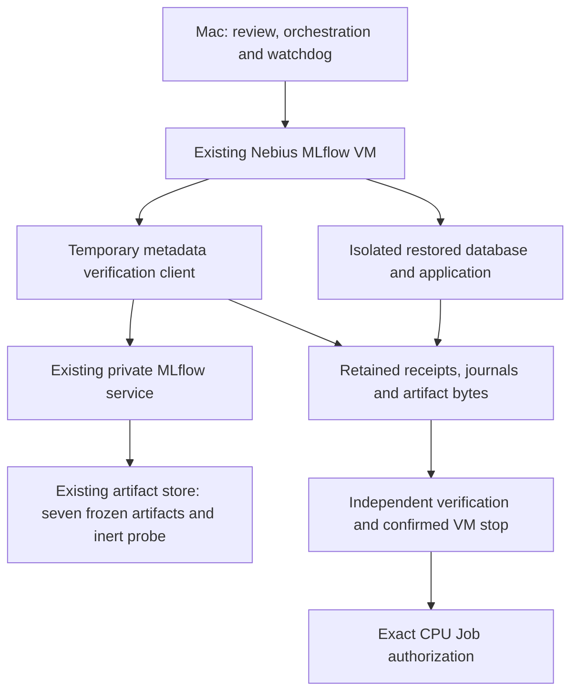

# MLflow readiness design — 2026-10-02

As a validation engineer,
I want restored tracking, frozen registry lineage and restricted Transformer logging verified,
So that subsequent experiment records have trustworthy identities and retained evidence.

Actor: validation engineer. Goal: establish the MLflow prerequisites for the CPU
role audit. Value: reproducible experiment records without reopening G8/G9.
Ticket: [#19](https://github.com/khab40/lob-arena/issues/19); consumer
[#24](https://github.com/khab40/lob-arena/issues/24); [Project #3](https://github.com/users/khab40/projects/3).

## Acceptance scenarios

```gherkin
Feature: MLflow readiness for governed development

  Scenario: Use the retained metadata through the restored application
    Given the retained backup matches its approved hash and original table fingerprints
    When the same deployed MLflow image starts against the isolated restored database
    Then its initial table fingerprints remain unchanged
    And authenticated metadata writes can be read back
    And new experiment and user IDs exceed the restored maxima
    And the retained frozen-run metadata remains unchanged

  Scenario: Add only the required Transformer permissions
    Given existing non-admin writer and exporter accounts with no conflicting access
    When the approved Transformer namespaces and four grants are applied
    Then the writer has EDIT and the exporter has READ on both exact resources
    And prior identities, permissions, credentials and defaults remain unchanged

  Scenario: Refuse broader inherited permissions
    Given either account has conflicting effective or inherited access
    When readiness preflight inspects both accounts
    Then no permission mutation is attempted
    And readiness remains unverified

  Scenario: Reject unreviewed Transformer versions before grants
    Given the Transformer registered model contains a version without an alias
    When readiness inspects the namespace
    Then it stops before service grants or probe runs
    And it preserves every existing model record

  Scenario: Refuse an unverifiable Transformer namespace
    Given version existence cannot be read from the Transformer namespace
    When readiness inspects that namespace
    Then it does not establish readiness or add permissions

  Scenario: Verify restricted parent and child tracking
    Given a durable journal bound to the approved maintenance proposal
    When the writer records one metadata-only parent and child
    Then the inert child artifact is read back byte for byte
    And the exporter can read both completed runs
    And its attempted child tag write is denied with HTTP 403
    And that tag is absent on writer readback

  Scenario: Retain an ambiguous mutation without another attempt
    Given a creation or probe intent was persisted before a lost response
    When the same journal is inspected again
    Then matching existing run identities may be reconciled by readback
    And an unresolved mutation is not automatically repeated

  Scenario: Register only the verified frozen research lineage
    Given the frozen run and its exact feature release and dataset lineage match
    And all seven artifact sizes and hashes match the retained manifest
    When research registration is explicitly authorized
    Then one matching version has the research-baseline alias
    And its tags bind the candidate, freeze, inventory and feature release
    And no production alias or deployable-flavor claim is created

  Scenario: Stop on a changed artifact or registry conflict
    Given an artifact, lineage field, existing version or alias conflicts
    When the registration helper verifies the frozen package
    Then registration does not establish readiness
    And no conflicting record is overwritten

  Scenario: Retain a guest startup failure safely
    Given one approved VM start with a bounded shutdown target
    When SSH or the existing application containers are not ready in time
    Then sanitized readiness observations explain the last observed state
    And application mutations are not attempted
    And shutdown evidence is retained without an automatic replacement

  Scenario: Preserve time for verification and cleanup
    Given isolated restore completed within the maintenance window
    When less than 220 seconds remain for live work and preservation
    Then the live client is not launched
    And restore evidence is retained while the VM is stopped
```

## Components and evidence

### Watchdog receipt and shutdown correction — Bug #387

Actor: platform operator. Goal: retain complete shutdown evidence and reach
emergency shutdown despite receipt or bookkeeping failures. Value: a failed
receipt cannot turn a bounded VM session into an unverified running session.
Ticket: [Bug #387](https://github.com/khab40/lob-arena/issues/387), under
[#24](https://github.com/khab40/lob-arena/issues/24), [Project #3](https://github.com/users/khab40/projects/3).
This section owns the correction's intended behavior. The earlier readiness
scenarios and historical attempts remain unchanged.

Scope: the existing watchdog, receipt publication, inert failure tests and
shutdown verification. Preserve its pinned VM, stopped-before-start ownership,
600-second deadline, existing retry/time bounds and subprocess-group cleanup.
Assumptions: the local filesystem supports atomic same-directory publication;
host, network and provider availability remain prerequisites for live stopping.
No VM start, provider call, model workload, credential access, permission change
or new live readiness acceptance is authorized by this correction.

```gherkin
Feature: Complete watchdog receipts and reachable emergency shutdown

  Scenario: WD-AC-01 Publish a complete receipt once
    Given a watchdog receipt destination has not been published
    When a reader observes it during publication or writer interruption
    Then the destination is absent or contains the complete JSON receipt
    And an existing destination is never overwritten

  Scenario: WD-AC-02 Refuse unverified receipt contents
    Given a result receipt is missing, unreadable, malformed or has invalid fields
    When a bounded session finalizes
    Then it attempts emergency shutdown and independent stopped-state readback

  Scenario: WD-AC-03 Stop despite bookkeeping failures
    Given a bounded session may have requested VM startup
    When stop signaling, child waiting or receipt publication fails
    Then the failure cannot skip emergency shutdown and stopped-state readback
    And retained diagnostic errors contain no raw exception text

  Scenario: WD-AC-04 Require exact stopped-state evidence
    Given a receipt claims shutdown success
    When the bounded session verifies that claim
    Then success requires the Boolean true and readback of the pinned VM as STOPPED
    And unverified shutdown raises the operator-intervention error

  Scenario: WD-AC-05 Preserve bounded session ownership and timing
    Given the existing bounded session startup and shutdown constraints
    When the corrected watchdog runs
    Then it refuses to adopt an already-running or differently sized VM
    And its startup, shutdown and subprocess cleanup bounds remain unchanged
```

Verification uses only inert providers and local process/filesystem fixtures.
Live readiness remains separately gated. Current increment mapping:

| Scenario | Implementation | Test/check | Evidence receipt | Status |
| --- | --- | --- | --- | --- |
| WD-AC-01 | `scripts/nebius_mlflow_watchdog.py:save` | `test_receipt_publication_is_complete_private_and_create_once`, `test_process_interruption_never_publishes_partial_receipt`, `test_atomic_publication_failures_leave_absent_or_complete_receipt` | `outputs/bug-fixes-387-reconciliation-20261013/iteration1/author-receipt.json` | Pass, inert |
| WD-AC-02 | `verified_stop`, `bounded_vm` | `test_invalid_result_always_reaches_emergency_readback`, `test_cleanup_bookkeeping_failure_cannot_skip_stop[unreadable]` | Same retained receipt; exact diff/specification pins in review | Pass, inert |
| WD-AC-03 | `bounded_vm` finalization | `test_cleanup_bookkeeping_failure_cannot_skip_stop`, `test_cleanup_retains_stop_evidence_without_replacing_primary_failure`, `test_verified_stop_reports_unavailable_evidence` | Same retained receipt | Pass, inert |
| WD-AC-04 | `verified_stop`, `stop_verified` | `test_stop_requires_pinned_well_shaped_independent_readback`, `test_unverified_stop_raises_intervention_even_when_receipt_writes_fail` | Same retained receipt | Pass, inert |
| WD-AC-05 | Existing startup/provider ownership | `test_cleanup_on_every_session_path`, `test_wrong_resource_preset_is_never_adopted`, `test_handshake_preserves_startup_window`, `test_provider_timeout_kills_the_entire_cli_process_group` | Same retained receipt | Pass, inert |



| Component | Responsibility | Required evidence |
| --- | --- | --- |
| Runtime preflight | Actual image imports, supported APIs, finite synchronous transport | Python/MLflow versions and signature checks |
| Isolated restore | Same image, private socket, original table equality, application writes | Image IDs, backup hash, table equality, allocated IDs |
| Permission helper | Inspect both users before adding exact missing grants | Exact resource IDs, additive readback; private SQL preservation boolean |
| Registry helper | Verify seven artifacts and all frozen input lineage before writes | Manifest/candidate/freeze/feature hashes, version, alias, durable intents |
| Tracking helper | Reserve parent/child, write/read inert artifact, verify exporter denial | Run IDs, journal bindings, artifact hash and denial result |
| Allowlist helper | Append only two namespace values | Preserved unrelated bytes and persisted additions |

The recovery probe's model versions reference an inert local path. Its 1→2
counter check applies to the new probe namespace, not a historical registered
model counter. Frozen-run snapshot checks cover the explicitly recorded fields;
broader initial preservation comes from database fingerprint comparison.

The live registry binds the seven artifacts through the immutable manifest hash.
Its version source remains the existing frozen `governed/model.txt`. It does not
load, score, retrain, calibrate or package that model.

## Verification and limits

Inert tests cover permission conflicts, state drift, partial failures, lost
responses, corrupt artifacts, lineage mismatch, stale sequences, configuration
preservation and strict denial classification. These tests execute no models.
Live readiness must be independently read back after the separately approved
[operation](../operations/mlflow-readiness.md); it is currently pending.
The first approved start exhausted its 45-second guest-readiness allowance before
staging. SSH began 35.89 seconds after provider RUNNING; the exact final Docker
condition was not retained. [Bug #280](https://github.com/khab40/lob-arena/issues/280)
adds safe observations and shared timing reserves. The replacement remains subject
to exact authorization; its 330-second application budget is not yet benchmarked.

Out of scope: final-test access, G8 evaluation, GPU/CPU Job execution, changing
thresholds or candidates, production promotion, live restore, deployment upgrade,
new cloud IAM/network permissions and full closure of platform stories.

See [ARD-0041](../architecture/ARD-0041-mlflow-readiness-before-transformer-execution.md)
for the decision and alternatives.

Compatibility references: [MLflow 3.13 client](https://github.com/mlflow/mlflow/blob/v3.13.0/mlflow/tracking/client.py),
[3.13 authentication](https://github.com/mlflow/mlflow/blob/v3.13.0/mlflow/server/auth/client.py),
and [artifact REST API](https://mlflow.org/docs/latest/api_reference/rest-api.html).
Current documentation does not replace the pinned deployed-image preflight.
